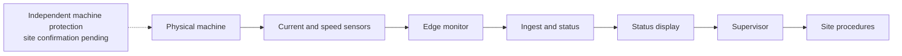

# Giles Domkam

### Structural & Computational Engineer (EIT) · AEC Technology · AI Systems

I build engineering software, AI operations tools, and applications that bring together technical work and human review. My background spans structural design, computational engineering, and software development.

**Focus:** structural analysis · Python · TypeScript · AI tooling · full-stack applications · verification and auditability

## Current CPS project at a glance

- **Problem:** small industrial machines, such as a plastic-recycling crusher, often run with no monitoring. A supervisor cannot see remotely whether the motor is running or overloaded, and an old reading shown as current is worse than none.
- **Solution (proposed design):** a read-only retrofit monitor. A clamp-on current sensor and a pulley speed sensor feed a small edge box; readings are validated, checked for clock trust, and shown as stale after 60 s. It has no path to machine control. Public synthetic examples implement the rules ([risks and timing](technical/cps-risks-timing.md)).
- **Status:** design stage. Synthetic examples run in CI. No field data, pilot result, customer deployment or independent review exists yet. The first read-only install is targeted for mid-December 2026, subject to written site authorization and confirmed anchoring ([roadmap](ROADMAP.md), [comparables](technical/comparables.md)).
- **Contact:** [udoka.the.afrikan@gmail.com](mailto:udoka.the.afrikan@gmail.com) or [GitHub](https://github.com/kamji-mfon). Demo: the synthetic web builds below, or run the checks in [the review process](technical/review-process.md).

### System context — proposed design

The proposed monitor observes and informs a person; it has no machine-control path. Independent machine protection is a site responsibility and has not been confirmed. The physical installation and display are **proposed**; selected software behavior is **synthetically tested**; field performance is **not established**. See the [trust-boundary view](technical/cps-architecture.md#trust-boundaries--proposed-design), [failure-state view](technical/cps-risks-timing.md#failure-states--synthetic-model), and [evidence map](technical/assurance.md#evidence-map--synthetic-freshness).

## Featured work

### [Industrial Monitoring — CPS Case Study](projects/cps-monitoring.md)

A sanitized monitoring scenario that connects physical data, validation, and human decisions. Includes a runnable synthetic example, architecture boundaries, risk analysis, and an assurance record.

**Skills:** industrial telemetry, systems architecture, failure analysis, Python, evidence-led design.

### [Njoya Engineering — Computational Design](projects/njoya-engineering.md)

Engineering calculation software designed to connect results with inputs, methods, code references, and human review.

**Skills:** structural engineering, Python, calculation workflows, provenance, validation.

### [Jarvis — Local-First AI Operations](projects/jarvis.md)

A voice-enabled operations assistant that brings together knowledge search, task preparation, and an approval workflow for selected actions.

**Skills:** Python, AI tools, voice interfaces, systems integration, operational controls.

### [Conny — Professional Networking](projects/conny.md)

A mobile networking application built around gatherings, mutual consent, and user safety.

**Skills:** TypeScript, React Native, Fastify, PostgreSQL, authentication, product design.

### Live demonstration builds — plant operations and filing console

Three tiers of one web application: [basic](https://diamond-plastics-basic.vercel.app), [intermediate](https://diamond-plastics-intermediate.vercel.app), and [advanced](https://diamond-plastics-advanced.vercel.app). **All data shown is synthetic and labelled as such.** The builds connect to no equipment, transmit no filings, and keep their approval ledger in memory only, so entries do not persist. They demonstrate the interface and approval flow, not a physical data path or production deployment.

## Additional work

- [Foumban — Architecture and Design Thinking](projects/foumban.md): architectural analogies and cloud patterns.
- [Research Systems — Merowi and ACG](projects/research.md): language and genetics research workflows with attention to provenance and uncertainty.
- [Other Builds](projects/other-builds.md): application prototypes, industrial compliance, and a macOS utility.

## Background

Structural and computational engineering · AEC technology · AI systems · application development · bid and tender workflows

B.S. Civil Engineering · California Engineer-in-Training (EIT)

Contact: [udoka.the.afrikan@gmail.com](mailto:udoka.the.afrikan@gmail.com) · [GitHub](https://github.com/kamji-mfon).

## Technical evidence

- [CPS architecture and boundaries](technical/cps-architecture.md)
- [CPS risks, timing, and failure semantics](technical/cps-risks-timing.md)
- [Evidence and assurance record](technical/assurance.md)
- [Observation contract and historian examples](technical/observation-evidence.md)
- [Engineering assurance case](technical/engineering-assurance.md)
- [Telemetry pipeline and local test evidence](technical/telemetry-pipeline.md)
- [Synthetic telemetry interface contract](technical/synthetic-interface-v1.md)
- [Proposed field evidence plan](technical/field-evidence-plan.md)
- [Security and disclosure](SECURITY.md)
- [Evidence roadmap](ROADMAP.md)
- [Comparable products](technical/comparables.md)
- [Public evidence and review process](technical/review-process.md)
- [Run the synthetic monitoring example](projects/cps-monitoring.md#public-evidence)

---

This portfolio describes selected work. Project source, client information, and internal systems are not included. Descriptions summarize capabilities and boundaries; they are not independent certifications or a substitute for professional review. All rights reserved; see [LICENSE](LICENSE).
