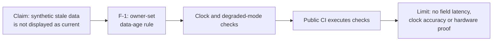

# Evidence and assurance record

[← Portfolio](../README.md) · [CPS case study](../projects/cps-monitoring.md)

Evidence types matter: a self-test is not an independent audit, simulation is not field validation, and a test of one path does not establish the behavior of an entire system.

## Evidence map — synthetic freshness

The claim is limited to the separately tested synthetic clock and state-machine examples. The [freshness requirement](cps-risks-timing.md#freshness-requirement-f-1) defines the data-age rule; `examples/check_clock_trust.py` and `examples/check_degraded_mode.py` exercise selected behavior; the [public workflow](../.github/workflows/portfolio-checks.yml) runs those checks. They do not demonstrate integrated deployment or prove physical safety. Consult the actual workflow run for its result rather than treating this diagram as a passing badge.

## Evidence register

| Claim | Evidence available | Limit |
|---|---|---|
| The public example distinguishes fresh, stale, and invalid synthetic readings | Run `python3 examples/check_monitoring_demo.py` | Illustrative implementation only; no hardware, clock security, or control path |
| A synthetic observation contract refuses missing, invalid, expired, and out-of-scope requests | Run `python3 examples/check_observation_contract.py` | Separate illustration; not evidence that private equipment access is gated |
| Synthetic historian records are separated by data quality | Run `python3 examples/check_historian_quality.py` | Separate illustration; not proof of real plant data or calibrated timing |
| A synthetic offline queue can model outage and replay, with duplicates and rejects distinguished | Run `python3 examples/check_telemetry_lab.py` | In-memory example; no authentication, network, persistent recovery, or real machine |
| A synthetic approval example can deny an action and reject a replay | Run `python3 examples/check_approval_demo.py` | Separate illustration, not Jarvis's implementation or a security certification |
| Old, backward-stepped or clock-mismatched synthetic readings are never shown as current | Run `python3 examples/check_clock_trust.py` and `python3 examples/check_degraded_mode.py` | Synthetic timeline; real clock accuracy and latency unmeasured |
| Synthetic readings with an altered value, wrong key, unknown device or replayed counter are refused | Run `python3 examples/check_reading_auth.py` | No key provisioning, transport security or edge hardware; counter persistence across reboot not demonstrated |
| A versioned reading schema refuses incompatible and unknown fields | Run `python3 examples/check_reading_schema.py` | Synthetic schema, not a deployed interface |
| Concurrent sensor and uploader threads lose no reading without counting it | Run `python3 examples/check_edge_buffer.py` | CPython threads on a CI runner; not the real edge box's scheduler or memory |
| A synthetic statics example closes vertical equilibrium for a symmetric load | Run `python3 examples/equilibrium_demo.py` | Illustrative calculation only, not a design, code check, or validation of the private engine |
| An industrial protocol simulator was exercised locally | Local self-check printed `sim selftest: all assertions passed` on 2026-11-26 | Its assertions are non-fatal, so the success line alone is not a reliable pass; private working tree; simulator, not real equipment |
| A file-based availability calculation rejects non-increasing timestamps and invalid thresholds | Local availability self-check reported all checks passed on 2026-11-26 | Private working tree; synthetic values; no production freshness or availability guarantee |
| Selected telemetry pipeline scenarios passed locally | Isolated private-branch run reported `11 passed, 1 skipped` on 2026-11-26 | Synthetic inputs; skipped Modbus test; not publicly reproducible; [details](telemetry-pipeline.md) |
| A selected approval workflow can defer, deny, and confirm an action | Local Jarvis confirmation test file reported `11 passed` on 2026-11-26 | Private working tree with local changes; uses test actions and local test server; not proof for every integration |
| The structural validation harness matched its selected expectations | Local harness reported `24 pass, 0 fail, 0 skipped` on 2026-11-26 | Mixed hand/equation and cited reference cases; private working tree; does not validate all modules or establish a professional seal |

The private repositories and inputs are not published. These observed results are first-party reports, not publicly reproducible evidence. The public classifier and checks are reproducible from this repository. See the [engineering assurance case](engineering-assurance.md) for selected sign-off, provenance, and citation checks. No values above should be read as a benchmark, system-wide coverage percentage, or independent certification.

## Open assurance work

- Confirm authorization, source provenance, and the relevant physical system before testing actual equipment.
- Establish device identity, data mapping, units, safety ownership, deployment boundaries, and operator requirements.
- Measure timing and resource behavior on the actual hardware and network before making operational claims.
- Record versioned evidence, review changes, and validate the specific intended use before relying on results.
