# Industrial monitoring — architecture and boundaries

[← CPS case study](../projects/cps-monitoring.md)

This is a design analysis of the proposed read-only crusher monitor (see the [README summary](../README.md#current-cps-project-at-a-glance)). Every public executable component is a synthetic example. Nothing here describes a deployed or verified system. The edge box hardware, network and site layout are NOT ESTABLISHED.

## Physical and decision flow

```text
Crusher motor supply ── clamp-on current sensor ─┐
Crusher pulley ──────── inductive speed sensor ──┤ (no electrical connection to machine control)
                                                 ▼
                     Edge box: timestamp, tag (HMAC), buffer
                                                 ▼  uplink, may be down
                     Ingest: verify tag, schema, clock trust
                                                 ▼
                     Display: current / stale (>60 s) / withheld / no data
                                                 ▼
                     Supervisor decides whether to go to the machine
                                                 ▼
                     Site procedures and the motor's own overload protection act
```

The monitor ends at a person. It has no path to start, stop or adjust the machine.

## Trust boundaries — proposed design

```mermaid
flowchart LR
    subgraph Site["Physical site — not field-verified"]
        Machine["Machine"] --> Sensors["Proposed sensors"]
        Sensors --> Edge["Proposed edge monitor"]
    end
    subgraph Service["Ingest boundary — proposed"]
        Verify["Verify integrity and schema"] --> Clock["Check clock and freshness"]
    end
    subgraph Human["Human decision boundary"]
        Display["Status display — proposed"] --> Person["Supervisor"]
    end
    Edge -->|"Proposed uplink"| Verify
    Clock -->|"Classified information"| Display
    Person --> Procedure["Separate site procedures"]
```



The physical site, uplink, ingest, display, and human decision each cross a distinct responsibility boundary. Public examples test selected integrity, schema, and clock rules using synthetic data; they do not establish real device identity, key provisioning, transport security, equipment behavior, or human response. The complete crossing requirements and gaps are in the table below. The monitor does not issue control commands.

## Boundaries and composition

| Crossing | Information | Required property | Public evidence | Gap |
|---|---|---|---|---|
| Machine → sensors | Motor current, pulley speed | Non-contact or clamp-on mounting; no connection to control wiring; installation only after written authorization and anchoring | None (proposed design) | Sensor models, calibration and mounting NOT ESTABLISHED |
| Sensors → edge box | Analog or pulse signals | Known units and sampling | None | Signal conditioning not designed publicly |
| Within edge box | Readings from several sensors | Concurrent writers do not corrupt or silently lose data | `check_edge_buffer.py`: two sensor threads and an uploader; every reading is uploaded, retained or counted as dropped | Thread model on the real box not established |
| Edge box → ingest | Tagged readings over an uplink that may fail | Integrity, device identity, replay rejection, versioned format | `check_reading_auth.py` (HMAC tag, per-device key, sequence counter); `check_reading_schema.py` (compatibility rule) | Key provisioning, transport security and counter persistence not demonstrated |
| Ingest → display | Classified readings | Old or untrusted readings never shown as current | `check_clock_trust.py` (60 s rule, backward steps, offsets); `check_degraded_mode.py` | Real latency and clock accuracy unmeasured |
| Display → supervisor | Status with age | Supervisor can tell current, stale, withheld and no-data apart | Display labels in `degraded_mode.py` | No user interface or human-factors test |
| Supervisor → machine | Human action under site procedures | Independent overload protection and emergency stop | Outside the monitor by design | Site confirmation of emergency stop and guarding pending |

**Composition.** The synthetic examples separately model an uplink outage with counted buffer drops, stale readings, clock faults, and refused forged or replayed readings. Their intended composition is to withhold untrusted information and recover only after consecutive current readings; the components are **not tested end to end**. These examples do not establish the worst possible combined outcome or prove that a wrong value cannot be shown as current.

## Aspects and facets

| Aspect | Conceptualization | Realization (synthetic) | Assurance: evidence and gap |
|---|---|---|---|
| Functional | Support the overload watch with current and speed | Classifier, clock guard, degraded modes | Synthetic checks only; no real signal |
| Business | Low-cost retrofit for a machine with no monitoring | None | Cost not measured; [comparables](comparables.md) list similar products |
| Human | Supervisor must tell current from stale or withheld data | Four display labels | No human-factors test |
| Trustworthiness | Integrity, replay, clock and loss of visibility | HMAC verifier, clock guard, state machine | Synthetic; [risk budget](cps-risks-timing.md#draft-qualitative-risk-budget-for-approval-not-approved) awaits site-owner approval |
| Timing | Reading older than 60 s is stale (requirement F-1) | `clock_trust.py` | Boundary tested; real latency unmeasured |
| Data | Versioned reading with units | `reading_schema.py` 1.0 and 1.1 | Real sensor mapping not established |
| Boundaries | Monitor ends at a person; no control path | Crossing table above | Install preconditions pending |
| Composition | Failures combine to "no current data", not a false current value | Combined examples | Not tested end to end |
| Lifecycle | Change, rollback and retirement below | Schema compatibility rule | Update mechanism not built |

## Lifecycle

| Stage | Proposed practice | Status |
|---|---|---|
| Change | Every change through a reviewed pull request with CI; schema changes follow the compatibility rule (new optional field = minor version, anything else = major version) | Practised for this repository; edge software not built |
| Deployment | Install only after written authorization, anchoring, and the site's confirmation of emergency stop and guarding | Preconditions pending |
| Update | Ingest must accept the edge box's schema version before the edge box is updated, so ingest is upgraded first | Proposed |
| Rollback | Reinstall the previous edge software version; readings written by a newer minor version stay readable only by a reader of that version or later | Proposed; not tested |
| Retirement | Remove clamp and speed sensors, revoke the device key, and keep or delete data as the site owner decides | Proposed |

## Trade-offs

| Decision | Chosen | Alternative | Why, and what it costs |
|---|---|---|---|
| Control authority | Read-only; no actuation | Let the monitor trip the motor on overload | Avoids making the monitor a safety function. Cost: the monitor cannot prevent damage, only inform |
| Freshness limit | 60 s (owner requirement) | Shorter, e.g. 5 s | Allows older observations to remain labeled current for longer. This is a data-age rule, not an overload-detection deadline; detection latency is not established |
| Recovery | 3 consecutive current readings before `normal` | Trust the first good reading | Avoids flicker after a fault. Cost: slower to show `normal` after recovery |
| Unknown schema fields | Reject | Ignore | Never silently drops data the reader does not understand. Cost: the edge box cannot add a field before ingest is upgraded |
| Integrity | HMAC with a shared per-device key | Public-key signatures | Standard library and cheap on small hardware. Cost: ingest holds keys that could forge readings; key storage on both ends matters |
| Buffer overflow | Drop oldest and count | Block sensors, or drop newest | Keeps the most recent state, which the overload watch needs. Cost: one shared buffer lets a busy sensor evict another sensor's readings entirely; per-sensor buffers would prevent that at the cost of fixed memory per sensor |
| Clock trust | Compare edge time with receipt time; withhold on mismatch | Trust edge time | Catches an unsynchronized edge clock. Cost: needs a correct ingest clock, which is itself unverified |

These choices are design decisions for the synthetic examples. They have not been validated on the machine.
