# Industrial monitoring — risks and timing

[← CPS case study](../projects/cps-monitoring.md)

This is an initial cross-property risk analysis, not a certified hazard analysis. Proposed controls are design requirements unless explicitly marked as demonstrated. No numerical risk budget has been allocated because severity, exposure, and system requirements have not been established.

| Scenario | Connected concerns | Expected response or proposed control | Control owner (role) | Evidence and remaining gap | Residual risk |
|---|---|---|---|---|---|
| Old reading appears current | Safety, reliability, timing | Mark stale and prevent it being presented as current | Software maintainer | Public synthetic classifier marks data stale; actual clock accuracy and end-to-end latency not measured | NOT ESTABLISHED |
| Missing, non-finite, or future-dated input | Reliability, timing, safety | Reject the reading and surface invalid state | Software maintainer | Public synthetic checks cover examples; no real sensor mapping tested | NOT ESTABLISHED |
| Unauthorized device access | Security, safety, reliability | Authorization, least privilege, network segmentation, and read-only access | Site owner and network administrator | Design requirements; actual network and access controls not demonstrated | NOT ESTABLISHED |
| False or manipulated observations | Security, safety, human decision | Verify source and data integrity; show uncertainty; use independent procedures | Site owner, operator | Synthetic HMAC tag and replay counter demonstrated by `check_reading_auth.py`; key provisioning, transport security and operator procedures not demonstrated | NOT ESTABLISHED |
| Collector or host stops | Reliability, resilience, timing | Detect missing data and communicate loss of visibility | Software maintainer, operator | Synthetic stale behavior only; detection latency and recovery bounds unmeasured | NOT ESTABLISHED |
| Sensitive operational data exposed | Privacy, security, business | Minimize data, restrict access, and review public artifacts | Data owner (site owner) | Public example uses invented values; actual deployment controls not assessed | NOT ESTABLISHED |

Roles are the parties who would own each control in a real deployment; no named person or organization has accepted them. Residual risk cannot be rated until severity, exposure, and tolerances are set for an actual system.

## Draft qualitative risk budget (for approval, not approved)

**Status: DRAFT, 2026-11-26.** The owner (Giles Domkam) proposed the ratings below on 2026-11-26. They must be approved by the site owner before the sensor install; until then the budget is not in force and gate G3 is unmet. The S2 ratings assume the site keeps motor overload protection and emergency stopping independent of this monitor; if that assumption fails, the ratings must be redone.

Severity scale (proposed): **S1** information inconvenience only; **S2** lost production time or rework; **S3** equipment damage or injury needing first aid; **S4** serious injury.

Tolerance scale (proposed): **Unacceptable**, resolve before install; **Tolerable**, accept with the listed controls and review after the first 14 days of data; **Acceptable**, no action beyond monitoring.

| Scenario | Severity (owner proposal) | Tolerance (owner proposal) | Site-owner approval |
|---|---|---|---|
| Old reading appears current during an overload | S2 | Tolerable | PENDING |
| Missing, non-finite, or future-dated input | S2 | Tolerable | PENDING |
| Unauthorized device access | S2 | Tolerable | PENDING |
| False or manipulated observations | S2 | Tolerable | PENDING |
| Collector or host stops | S2 | Tolerable | PENDING |
| Sensitive operational data exposed | S2 | Tolerable | PENDING |
| Sensor installation near the running machine before anchoring and guarding are confirmed | S4 | Unacceptable | PENDING |

No sensor may be connected before written site authorization and confirmed anchoring, whatever the ratings.

## Proposed consequence-led allocation

For a future field deployment, prioritize resources first around physical harm from incorrect human decisions, then unauthorized or manipulated observations, then recoverability and data confidentiality, subject to the actual hazard analysis. This is an illustrative ordering, not an approved allocation or a quantified risk budget. The operator, site owner, and responsible engineer must determine consequences, tolerances, control owners, and residual-risk acceptance for the particular system.

## Timing and failure semantics

### Proposed timing class

**Class: non-real-time, staleness-bounded monitoring (proposed design classification, not a measured result).** Justification: the monitor has no actuation path and no control deadline; its output informs a person who acts on human timescales through separate plant procedures. Missing a delivery deadline therefore degrades information quality (a reading becomes stale) rather than causing a control failure. The correctness requirement is that an old or untrustworthy reading is never presented as current, not that a reading arrives within a hard deadline. This classification would change if the system ever drove an interlock, alarm with a required response time, or actuator; that would require a new hazard analysis and a hard or firm real-time design.

Not applicable to this classification, and not tested: interrupt service routines, DMA, hardware watchdogs on a controller, deterministic scheduling, and worst-case execution time analysis. The monitor reads sensors through an edge box and never runs inside the machine's controller, so it has no interrupt handler of its own. If the chosen edge hardware counts speed pulses with an interrupt, that handler's timing becomes a requirement and must be analysed then.

Concurrency that does apply: on the edge box, sensor readers and the uploader share one buffer. `examples/edge_buffer.py` uses a lock-protected buffer with a drop-oldest, count-every-drop policy. `check_edge_buffer.py` runs two sensor threads and an uploader at once and checks that every reading is uploaded, retained or counted as dropped, with each sensor's order preserved. The check also documents a limitation: one busy sensor can evict all of another's readings from a shared buffer (see [trade-offs](cps-architecture.md#trade-offs)). This is CPython threading on a CI runner, not the edge box's real scheduler.

### Time-source threat model

| Threat | Effect on the monitor | Proposed detection | Proposed response | Status |
|---|---|---|---|---|
| Edge clock not synchronized after power loss (no RTC) | Readings carry wrong timestamps; fresh data may look stale or old data current | Compare edge time with ingest receipt time | Mark readings time-uncertain; do not show as current | Offset flag demonstrated on synthetic input by `check_clock_trust.py`; clock source of a real edge device NOT ESTABLISHED |
| Clock steps backward | Duplicate or out-of-order timestamps | Reject non-increasing timestamps per signal | Reject; monitor enters degraded mode | Demonstrated on synthetic input by `check_clock_trust.py` and `check_degraded_mode.py` |
| Clock runs fast (future-dated readings) | Reading appears fresher than it is | Reject timestamps later than receiver time | Classify invalid | Demonstrated on synthetic input by `check_monitoring_demo.py` and `check_telemetry_lab.py` |
| Malicious or misconfigured time server | Coordinated wrong time across devices | Cross-check independent sources; alert on large offsets | Stop relying on time-sensitive outputs; operator alert | Design proposal; no NTP/PTP/GNSS implementation claimed |
| Ingest host clock wrong | Freshness decisions wrong for every device | Monitor host sync state | Alert maintainer; mark status uncertain | Not demonstrated |

Allowable reading age is set for one decision (see [freshness requirement](#freshness-requirement-f-1)). Clock accuracy, the edge-to-ingest offset limit for a real device, and holdover duration remain open requirements for the actual site.

### Freshness requirement F-1

**Owner requirement, set 2026-11-26.** A reading older than 60 s at the time it is displayed must be shown as stale, never as current.

- **Decision supported:** a supervisor's load and overload watch on the crusher motor, that is, whether to go to the machine. It is an information aid, not a protective function. Motor overload protection and emergency stopping must remain independent of this monitor and are owned by the site.
- **Owner:** Giles Domkam, software maintainer, owns this requirement and its implementation. The site owner owns the physical installation and any machine safety function.
- **Evidence:** demonstrated on synthetic input by `examples/check_clock_trust.py`, including the 60 s boundary (60 s current, 61 s stale) and readings that arrive already stale. Not measured on hardware: end-to-end latency from sensor to display, and the accuracy of the clocks that stamp and judge age, are NOT ESTABLISHED.

### Clock trust and degraded mode

`examples/clock_trust.py` classifies each synthetic reading per signal: **rejected** (invalid, repeated, or backward timestamp), **time-uncertain** (edge timestamp differs from ingest receipt time by more than a configurable offset, or receipt is later than the host clock), **stale** (older than 60 s), or **current**. Only current and stale readings advance the per-signal timestamp, so one future-dated reading cannot lock out later correct ones. The offset value used in the checks (2 s) is illustrative, not a site requirement.

`examples/degraded_mode.py` is an explicit state machine with a total transition table, checked by `check_degraded_mode.py`:

### Failure states — synthetic model

```mermaid
stateDiagram-v2
    [*] --> NoVisibility
    NoVisibility: No visibility
    Degraded: Degraded
    Recovering: Recovering
    Normal: Normal
    NoVisibility --> NoVisibility: stale or rejected
    NoVisibility --> Degraded: time-uncertain
    NoVisibility --> Recovering: current
    Degraded --> Degraded: rejected or time-uncertain
    Degraded --> NoVisibility: stale
    Degraded --> Recovering: current
    Recovering --> Recovering: current, streak below threshold
    Recovering --> Normal: current, streak reaches threshold
    Recovering --> Degraded: rejected or time-uncertain
    Recovering --> NoVisibility: stale
    Normal --> Normal: current
    Normal --> Degraded: rejected or time-uncertain
    Normal --> NoVisibility: stale
```

The synthetic model begins with no visibility. Current readings start recovery; the configured consecutive-reading threshold returns the model to normal. Stale readings lead to no visibility, and rejected or time-uncertain readings lead to degraded mode except that rejection while already without visibility leaves it there. Only normal is labeled current. These are information states, not physical safe states. Reproduce the behavior with `python3 examples/check_degraded_mode.py` and `python3 examples/check_clock_trust.py`; no field timing is implied.

| Mode | Entered when | Display rule |
|---|---|---|
| no-visibility | Start-up, or no trusted reading within 60 s | No current data; check the machine in person |
| degraded | A reading is rejected or time-uncertain | Value withheld |
| recovering | Current readings resume after degraded or no-visibility | Value shown, labelled not yet trusted |
| normal | 3 consecutive current readings (illustrative tuning value) | Value shown as current |

Only `normal` presents a value as current. An unknown mode or event raises an error rather than falling through. These modes describe the monitor's information state; they are not machine safe states.

### Synthetic example behavior

The public example compares synthetic timestamps against the owner-set maximum age. It does not establish clock synchronization accuracy, worst-case execution time, detection latency, or a field recovery bound. Its proposed non-real-time classification is not a measured result. Timestamp checks alone are not a defense against clock spoofing.

For an actual system, identify the clock source, allowable age per decision, timestamp provenance, loss and spoofing threats, detection behavior, backup/holdover, and a safe operating procedure. Those requirements and measurements remain open. No GNSS, PTP, or NTP implementation is claimed.

Possible threats include clock loss, backward steps, misconfiguration, and a malicious or incorrect time source. A proposed response is to detect implausible time or lost synchronization, mark data uncertain, alert the operator, and use an approved holdover or stop relying on time-sensitive outputs. This is a design proposal, not an implemented detection-to-failover guarantee.

The example's failure state is **invalid or stale information**, not a machine safe state. The physical safe state, its owner, and any fail-safe or fail-operational decision depend on the actual equipment and must be established separately.

## Measured resource use of the public examples

**Reproducible public test, CI runner only.** Measured by `examples/check_resource_use.py` in [workflow run 45891931259](https://github.com/kamji-mfon/giles-domkam-portfolio/actions/runs/45891931259) on commit `543e060` (merged to main as `0343c46` with an identical tree): GitHub-hosted `ubuntu-latest`, Python 3.14.4, Linux x86_64, 4 CPUs. Method: each script runs five times in a child interpreter; wall time (`time.perf_counter`, includes interpreter start-up) and CPU time (user plus system, from `os.wait4`) are medians; peak memory is the largest per-process `VmHWM` reported by the child. Shared-runner noise is not controlled, so treat differences of a few milliseconds as noise.

| Script | Median wall (ms) | Median CPU (ms) | Peak RSS (KiB) |
|---|---:|---:|---:|
| check_approval_demo.py | 20 | 20 | 10968 |
| check_clock_trust.py | 21 | 21 | 11404 |
| check_degraded_mode.py | 21 | 21 | 11156 |
| check_edge_buffer.py | 49 | 49 | 11796 |
| check_historian_quality.py | 27 | 26 | 12492 |
| check_monitoring_demo.py | 25 | 25 | 12160 |
| check_observation_contract.py | 22 | 22 | 11488 |
| check_reading_auth.py | 30 | 30 | 17160 |
| check_reading_schema.py | 21 | 21 | 11536 |
| check_telemetry_lab.py | 22 | 22 | 12964 |
| equilibrium_demo.py | 20 | 20 | 11164 |

The job fails if any check exceeds 5 s median wall time or 100 MiB peak memory; those are smoke thresholds, not requirements. These figures say nothing about the edge box: its CPU, memory, power and sensor-to-display latency are NOT ESTABLISHED until measured on the installed hardware. Every CI run republishes the table in its job summary.
